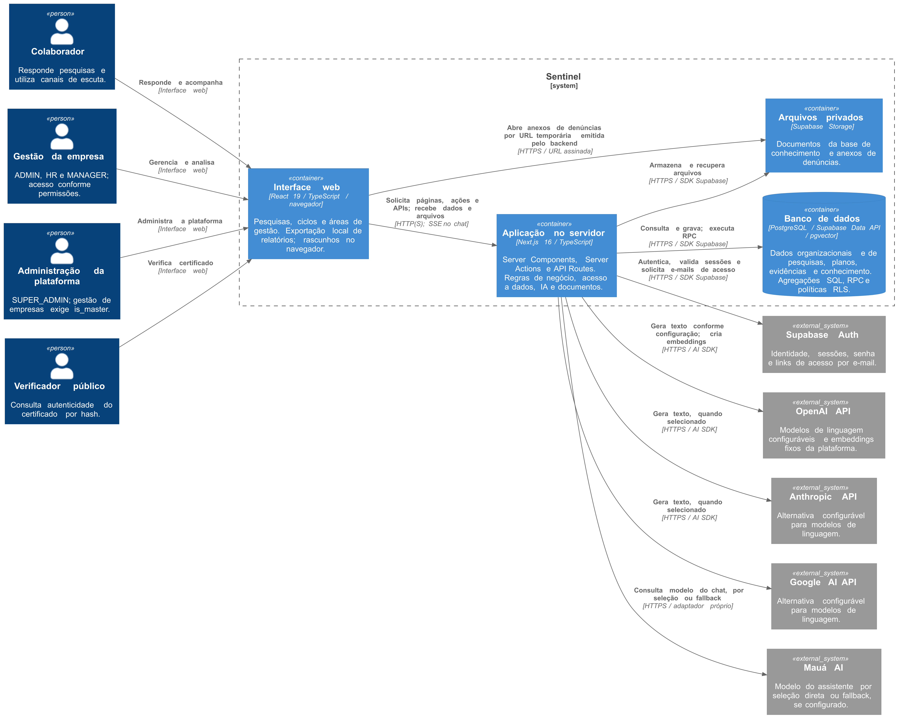
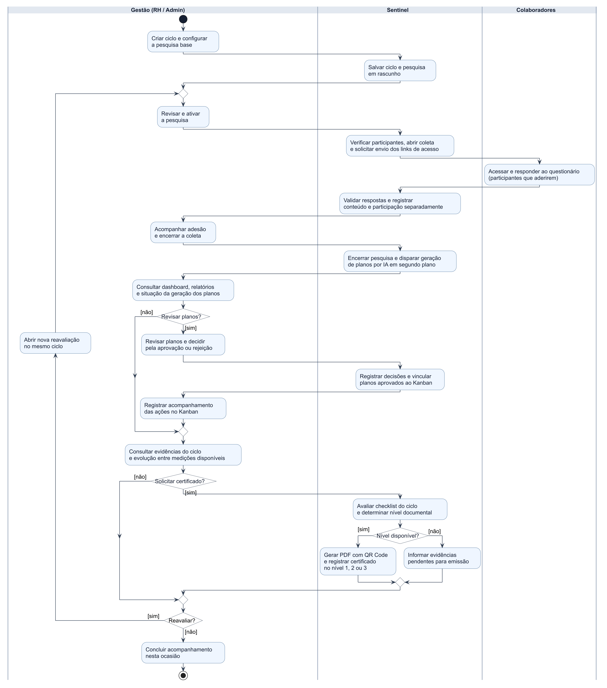

# Diagramas e Material Complementar do TCC

Esta página reúne as figuras técnicas atuais do Sentinel para consulta da banca e como material complementar ao artigo. Os dois diagramas indicados abaixo são as versões de referência desta documentação.

## Diagramas Atuais

| Figura | Conteúdo | Imagem vetorial | Imagem em alta resolução | Fonte editável |
| --- | --- | --- | --- | --- |
| Arquitetura geral | Modelo C4, nível 2: pessoas, interface web, aplicação no servidor, banco de dados, arquivos privados e serviços externos. | [Abrir SVG](atuais/arquitetura-geral.svg) | [Abrir PNG](atuais/arquitetura-geral.png) | [PlantUML](atuais/arquitetura-geral.puml) |
| Atividades do ciclo de pesquisas | UML: criação, aplicação, diagnóstico, planos, acompanhamento, avaliação documental para certificação e reavaliação no mesmo ciclo. Versão completa com raias de responsabilidade e retorno pela esquerda. | [Abrir SVG](atuais/atividades-ciclo.svg) | [Abrir PNG](atuais/atividades-ciclo.png) | [PlantUML](atuais/atividades-ciclo.puml) |

Para leitura ampliada, abra a imagem pelo link da tabela. Para inserir no artigo, prefira SVG ou PNG em alta resolução e preserve a proporção da figura.

### Arquitetura Geral do Sistema

[](atuais/arquitetura-geral.svg)

O limite do sistema representa a responsabilidade lógica do Sentinel. A presença de PostgreSQL e Supabase Storage dentro desse limite não significa que esses serviços sejam hospedados no processo do Next.js. Supabase Auth e provedores de IA aparecem como integrações externas. Os provedores de IA disponíveis dependem da configuração; o diagrama não exige que todos sejam utilizados em cada operação.

### Atividades do Ciclo de Pesquisas

[](atuais/atividades-ciclo.svg)

A figura representa o fluxo principal de acompanhamento, com uma pessoa da gestão autenticada e autorizada. As raias identificam as responsabilidades da gestão, do Sentinel e dos colaboradores.

- A pesquisa base é criada dentro de um ciclo. A reavaliação é aberta no próprio ciclo e nasce em rascunho, preservando instrumento, versão e setores da base; não exige escolher outra pesquisa.
- O encerramento da coleta é uma decisão da gestão, sem exigir resposta de todos os convidados. A geração dos planos é disparada em segundo plano e pode falhar ou terminar sem planos.
- A aprovação dos planos permite vinculá-los a tarefas do Kanban, conforme a configuração operacional. O diagrama não exige concluir todas as tarefas antes de solicitar um certificado.
- A emissão depende das evidências registradas no ciclo e pode produzir nível documental 1, 2 ou 3. O nível 3 requer reavaliação e comparação disponíveis; o código não exige melhoria de todos os indicadores. O documento não representa uma declaração automática de conformidade legal integral.
- O nó final encerra o acompanhamento naquela ocasião; não encerra definitivamente o ciclo nem remove seus registros.

## Referência da Implementação

As figuras foram elaboradas a partir do commit [`828cb46`](https://github.com/brunostorti/Sentinel/commit/828cb4605959d318ec2725ce4c2f47e05aca6625). A compatibilidade dos fluxos e integrações representados foi reconferida em 5 de novembro de 2026 com o commit [`1cd225b`](https://github.com/brunostorti/Sentinel/commit/1cd225b2fe29ba5022261e5317fc40c667eb7ff9), utilizado como base desta atualização documental.

Entre essas versões, os arquivos centrais de criação/reavaliação/encerramento das pesquisas, submissão das respostas, definição de níveis do certificado, emissão do certificado, aprovação dos planos e orquestração do pipeline permaneceram sem alterações. As novas funcionalidades de segundo fator e registro de uso de documentos permanecem nos mesmos containers da visão arquitetural. Esta é uma visão geral, não um inventário de todas as telas e rotas.

Principais pontos de consulta no código:

| Assunto | Implementação |
| --- | --- |
| Criar ciclo, ativar, encerrar e criar reavaliação | [actions.ts](../../src/app/%28dashboard%29/gerenciar-pesquisas/actions.ts) |
| Validar e registrar respostas | [actions.ts](../../src/app/%28colaborador%29/responder/%5BsurveyId%5D/actions.ts) |
| Checklist do ciclo e níveis de certificação | [cycle.ts](../../src/lib/surveys/cycle.ts) |
| Emitir certificado | [route.ts](../../src/app/api/certificates/generate/route.ts) |
| Aprovar plano e vincular tarefa | [route.ts](../../src/app/api/action-plans/%5Bid%5D/approve/route.ts) |
| Orquestrar geração de planos | [orchestrator.ts](../../src/lib/ai/pipeline/orchestrator.ts) |
| Provedores de IA e embeddings | [provider-factory.ts](../../src/lib/ai/provider-factory.ts), [embeddings.ts](../../src/lib/rag/embeddings.ts) |
| URLs temporárias dos anexos de denúncias | [page.tsx](../../src/app/%28dashboard%29/denuncias/page.tsx) |

## Material Histórico

Os arquivos abaixo já existiam nesta pasta antes da atualização e foram preservados. Não são as figuras de referência atuais. Devem ser revisados antes de serem usados para descrever a implementação presente, pois retratam uma versão anterior do projeto.

| Arquivo preservado | Observação |
| --- | --- |
| [Arquitetura anterior](sentinel_arquitetura_visao_geral_pb.png) | Mostra a organização antiga por grupos de rotas e cita apenas Claude na camada de IA. A referência atual é a arquitetura C4 acima. |
| [Pipeline de IA anterior](sentinel_pipeline_ia_pb.png) | Registra uma visão anterior do pipeline baseada em Claude SDK. Atualmente há seleção de provedores e recursos de recuperação de conhecimento. |
| [Casos de uso anteriores](sentinel_diagrama_casos_de_uso.png) | Não representa o ciclo com reavaliações e níveis documentais de certificação como fluxo central. |
| [Requisitos funcionais e não funcionais](requisitos%20funcionais%20e%20n%C3%A3o%20funcionais.png) | Documento gráfico preservado para rastreabilidade; não foi atualizado nesta revisão. |
| [Versão do artigo já armazenada no repositório](ARTIGO%20OFICIAL%20%281%29.pdf) | PDF preservado; seu conteúdo não foi atualizado nesta revisão. |

## Notação e Reprodução

A arquitetura utiliza o [modelo C4 de containers](https://c4model.com/diagrams/container), descrito em PlantUML com a biblioteca C4. O fluxo utiliza os elementos de atividades da [UML 2.5.1](https://www.omg.org/spec/UML/2.5.1): início, ações, fluxos direcionados, decisões com guardas, merges, partições e fim de atividade.

O arquivo `atuais/arquitetura-geral.puml` pode ser renderizado com PlantUML e a biblioteca C4. Para reproduzir a disposição final do diagrama completo de atividades, execute na pasta `atuais`, com Node.js, `sharp` e PowerShell disponíveis:

```powershell
node renderizar-atividades.mjs
./ajustar-rotulos.ps1
node renderizar-atividades.mjs --png
```

O script de renderização envia apenas a descrição PlantUML ao serviço público de renderização. O ajuste SVG reposiciona guardas e encaminha o retorno da reavaliação pela esquerda, mantendo as mesmas ações e conexões. Os PNG e SVG finais já estão disponíveis na pasta, portanto não é necessário executar os scripts para consultar as figuras.

Sugestão de indicação no artigo: "Os diagramas completos e os respectivos arquivos editáveis estão disponíveis no repositório do projeto, em `docs/artigo_diagramas_tcc`. Fonte das figuras: elaboração dos autores."
